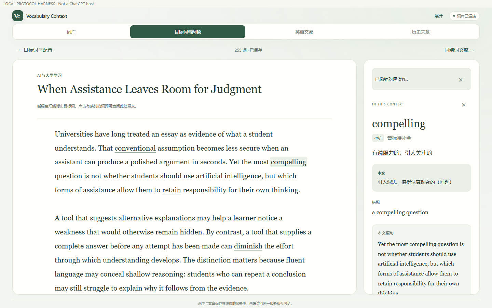

# Vocabulary Context

**把单词放回阅读与交流。** 支持 MCP Apps 的英语学习插件：用同一份个人词库准备阅读、获得逐处语境释义，并开展围绕目标词的英语交流。

文章生成、图片识别和语言分析由当前兼容宿主的模型完成。服务端没有模型 API 客户端，不需要模型 API Key；宿主订阅与插件能力仍取决于使用者账号。



## 核心功能

- 手动、批量或由宿主识别图片导入单词，逐项确认后保存。
- 五档熟练度、今日词与旧词筛选、反复遗忘记录、目标词换批。
- 按主题、篇幅与难度准备文章，校验词汇覆盖和位置标注后保存，支持历史重开。
- 每个出现位置独立的中文释义、学习反馈、撤销与阅读位置恢复。
- 独立英语交流流程；在已启用的交流中依据真实对话收录不理解的词。
- 持久化、请求去重、版本冲突保护，以及 OAuth 2.1 / PKCE 认证。

## 演示与在线入口

[阅读截图](docs/images/reading.png) · [平板词库](docs/images/library.png) · [宿主验收记录](docs/ACCEPTANCE.md)

Cloudflare MCP 地址规划为 `https://vocabulary-context.hellovian.workers.dev/mcp`。首次发布及验证状态见 [Cloudflare 指南](docs/CLOUDFLARE.md)。根网页介绍连接方法，学习 UI 在兼容宿主中打开。

每个部署对应一份个人词库；公开代码不等于共享词库。请部署自己的实例并使用自己的登录密码。独立桌面、平板和 Voice 的支持以真实验收为准；浏览器协议测试不等于宿主安装验收。

## 快速开始

需要 Node.js 24 LTS、npm 和支持远程 MCP / MCP Apps 的宿主。

```sh
npm ci
npm run build
```

本地开发：复制 `.env.example` 为 `.env`，设置至少 20 字符的 `VOCAB_OWNER_PASSWORD`，运行 `npm start`。服务默认监听 `127.0.0.1:8787`。远程宿主需要稳定 HTTPS 入口，长期使用推荐 Cloudflare 部署。

在宿主的自定义 MCP 设置中填写部署后的 `/mcp` URL，使用 OAuth 授权，并在授权页输入个人词库密码。安装边界见 [宿主支持记录](docs/HOST-SUPPORT.md)。

连接后尝试：

> 打开我的词库，加入 retain、compelling 和 impose，先让我确认。
>
> 用今天的词写一篇关于 AI 与大学学习的文章。

Skill 位于 `skills/vocabulary-context/`。远程 MCP 连接与宿主 Skill 安装是不同步骤，按宿主实际支持完成安装。

## Cloudflare 部署

```sh
npm ci
npm run build
npx wrangler secret put VOCAB_OWNER_PASSWORD
npm run deploy
```

将 `wrangler.jsonc` 的 `VOCAB_PUBLIC_URL` 设置为实际 HTTPS origin，用 `VOCAB_REDIRECT_URIS` 精确配置回调。Workers 与 SQLite Durable Objects 保存词库和 OAuth 记录，不依赖本机持续开机、临时隧道或 VPS。

GitHub Actions 在 `main` 推送后执行业务测试、构建和 Workers 运行时验收，再自动发布。仓库使用 secrets `CLOUDFLARE_API_TOKEN` 和 `CLOUDFLARE_ACCOUNT_ID`，词库密码只放在 Worker secrets 中。

本地 `data/` 不随 Git 或部署上传。迁移现有词库需先备份并验证新库，不能直接替换现有正式数据。见 [部署与迁移边界](docs/CLOUDFLARE.md)。

## 开发与测试

```sh
npm test                 # 业务、认证、协议与本地备份
npm run build            # 构建自包含 MCP App HTML
npm run test:cloudflare  # 打包并验收真实 Workers / Durable Object 运行时
npm run test:ui          # 桌面、平板、窄屏交互，使用合成数据
npm run package          # 生成供宿主安装的插件包
```

打包前通过 `scripts/configure-endpoint.mjs` 配置实际 MCP HTTPS 地址。源码及安装包不应包含真实 `.env`、数据库、日志或私有连接记录。本地调试与备份操作见 [本地开发说明](docs/LOCAL-DEVELOPMENT.md)。

## 技术栈与结构

React · MCP SDK / MCP Apps · Zod · Express · SQLite · esbuild · Playwright · Cloudflare Workers / Durable Objects

```text
web/                  阅读、词库与交流界面
server/service.mjs    学习业务、幂等与冲突控制
server/repository.mjs 本地 SQLite 存储
server/auth.mjs       OAuth 2.1 / PKCE
server/index.mjs      MCP 工具、资源与 HTTP 服务
cloudflare/           Durable SQL、云端入口、schema 与运行时验收
shared/               交流指令与共享逻辑
skills/               宿主学习工作流 Skill
scripts/              构建、打包、本地启动与备份
tests/               业务、认证、协议与 UI 验收
docs/                截图、连接说明与验收边界
plugin.json mcp.json   插件清单与连接描述
```

## 日常更新

```sh
git add .
git commit -m "Describe the change"
git push
```

`main` 检查通过后更新 Cloudflare，代码更新不重置词库。改变正式 origin 或 OAuth 回调时，宿主可能需要重新授权。

## Roadmap

- [x] 个人词库、熟练度、语境阅读与交流
- [x] OAuth、幂等、版本保护及本地备份
- [x] Cloudflare 持久化适配与运行时协议验收
- [ ] 完成首次公开服务发布与现有词库迁移验证
- [ ] 完成独立桌面、平板宿主的完整安装验收
- [x] 一致性备份、空库迁移与导入回执
- [ ] 云端定期备份及运维记录
- [ ] 更多阅读主题与学习统计

欢迎以合成词条和复现步骤反馈问题。勿附带真实数据库、OAuth 令牌或密码，安全问题见 [SECURITY.md](SECURITY.md)。
